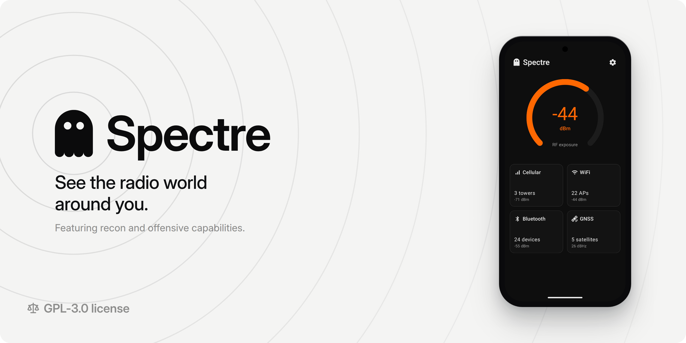

**Spectre** is an Android app for observing and interacting with the wireless environment around you. It monitors signals from Bluetooth devices, Wi-Fi access points, cellular towers, and GNSS satellites. Spectre also features a growing set of pentesting tools, constrained by Android's security model.

## Installation

**Minimum supported version: Android 12 (API 31)**

[](https://github.com/thomasbuilds/Spectre/releases/latest)
[](https://f-droid.org/packages/dev.thomasbuilds.spectre)
[](https://apps.obtainium.imranr.dev/redirect?r=obtainium://add/https://github.com/thomasbuilds/Spectre)

It's good practice to verify the APK's signing certificate against the [CERT.sha256](CERT.sha256) fingerprint before installing. Once Spectre is installed, grant the permissions it requests - they power the scanners, the GATT inspector, the local-network scan, and the monitoring notification, and nothing else. The app has no ads, trackers, or analytics.

## Features

- **RF exposure:** A single live dBm estimate of the total received RF power across cellular, Wi-Fi, and Bluetooth, shown on a gauge and in the monitoring notification once all three are measuring.
- **Cellular:** Serving and neighbor cells on 5G, 4G, 3G, and 2G with operator, identifiers, bands, reference measurements, and a timing-advance distance estimate where available, across every active SIM.
- **Wi-Fi:** Access points on the 2.4, 5, and 6 GHz bands with vendor, security, cipher, channel, width, and a distance estimate, including true FTM ranging (802.11mc, plus 802.11az on Android 15+) where the hardware supports it.
- **Bluetooth LE:** Advertising devices with name, MAC, vendor, RSSI, address type (Android 15+), PHY, service UUIDs, and decoded manufacturer data including iBeacon.
- **GNSS:** Multi-constellation tracking with dual-frequency support, carrier-to-noise, elevation, azimuth, range rate, and used-in-fix status.
- **Local-network scan:** Host discovery via TCP-connect probes and SSDP / UPnP, with banner grabbing, service fingerprinting, and reverse DNS, plus mDNS / DNS-SD service discovery.
- **GATT inspector:** Connect to a BLE device, enumerate its services and characteristics, and read and decode their values. Inspection is read-only.
- **Filter and sort:** Narrow the Wi-Fi list by band, security, WPS, or vendor and the Bluetooth list by manufacturer or address type (Android 15+). Sort both by signal strength or detection order, Wi-Fi also by name and Bluetooth by MAC address.
- **Theme:** Light, dark, or follow the system.

## Android limitations

**Signal strength is a reference measurement, not total power.** Modems report RSRP (4G), SS-RSRP (5G), or RSCP (3G), the power of a reference signal, not the power of the whole channel. Spectre reconstructs a wideband estimate per network type. LTE derives it from RSRP, RSRQ, and the bandwidth (15 MHz when unreported); without RSRQ it uses the modem's own RSSI or a bandwidth-derived offset. NR (5G) adds a fixed 30 dB for an assumed bandwidth, so wide, busy carriers read low and narrow ones high. WCDMA uses the modem's RSSI directly when it reports RSSI instead of RSCP; otherwise it derives the estimate from Ec/No when available and adds a fixed 10 dB when not. GSM is already a total-power figure, but Android caps it at -51 dBm, so a -51 dBm reading means ≥ -51 dBm. On lightly loaded 4G and 5G cells the estimate can read high. Tower rows, the cellular card, and the gauge all use this converted figure; expand a tower to see the raw RSRP, SS-RSRP, or RSCP.

**Powers cannot be added in dBm.** dBm is logarithmic, so per-emitter strengths cannot meaningfully be summed. Spectre converts each to linear power (milliwatts), adds them, and converts back, so the exposure figure is dominated by the strongest emitters. Cellular readings are first converted to the wideband figure above. Only the strongest cell per channel and the strongest access point per Wi-Fi channel count. Wi-Fi and Bluetooth readings are the strength of received packets, not a time average, so the total is an estimate rather than a calibrated measurement.

**5G NSA depends on the modem.** In 5G NSA the phone rides on a 4G anchor cell and adds a 5G carrier on top. If the modem lists the 5G carrier as a separate cell, Spectre shows it as its own 5G cell, marked Secondary serving when the modem flags it as one. Otherwise the strength shown for the connection is the anchor's, not the 5G signal carrying the data. Standalone 5G (5G SA) always has a 5G serving cell. The Modem line shows the network type Android reports, which can read 5G NSA as soon as the 4G cell can add a 5G carrier.

**Only your carrier's cells normally appear.** The modem measures the frequencies your SIM's network and its roaming partners point it to, so cells from other carriers rarely show up. Android's telephony APIs also report a single subscription by default, so Spectre monitors every active SIM to cover both carriers on a dual-SIM phone.

**Wi-Fi scan throttling.** Android lets each foreground app, including one running a foreground service like Spectre's monitor, start four Wi-Fi scans every two minutes. Spectre paces itself to one scan every 31 seconds while throttling is on, and one every 5 seconds once it is disabled in Developer options. It also consumes the results of system-initiated scans, so the list keeps updating even when its own scans are throttled.

**Distance is not handed to you.** Android gives no distance to most emitters. Spectre uses true ranging where it exists (Wi-Fi FTM, timing advance on the serving cell) and a path-loss model for other Wi-Fi and Bluetooth signals, calibrated for Bluetooth from the iBeacon measured power or the advertised TX power when a device sends one. Model estimates are only rough, and Wi-Fi and Bluetooth distances read Pending until enough samples arrive.

## Sponsor

Spectre is free, open-source, and ad-free. Donations toward its continued development are very welcome.

### Bitcoin

```
bc1qphgd8leqsf06qlm6jjxpuw2rtq9f9hdjnhfluh
```

### Monero

```
85fzziWM1pH77HWHNhE6aAN9uaHrLL7CMFA72rVecmMDR1fUjfv9YmS6GGeiV3hDEn7e9d8v4hfMSRmmEp171fpR4nipNfZ
```

Thank you for supporting the project.
